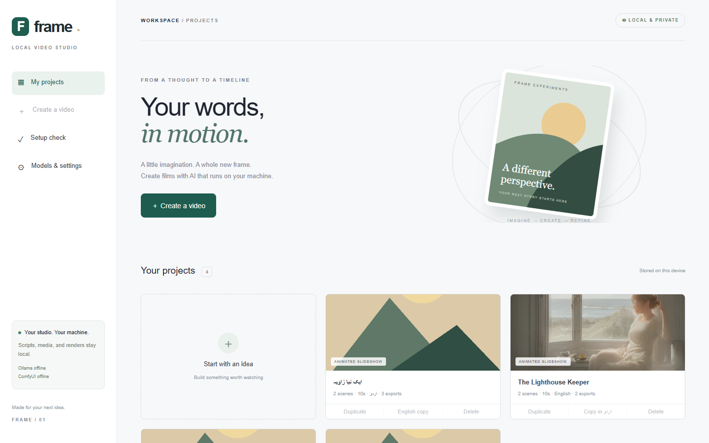
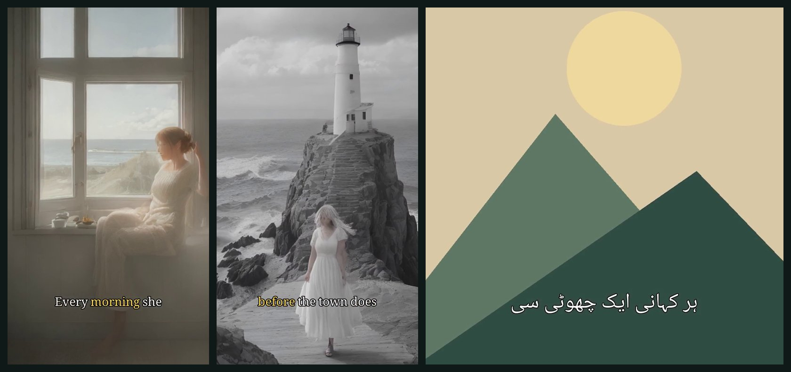
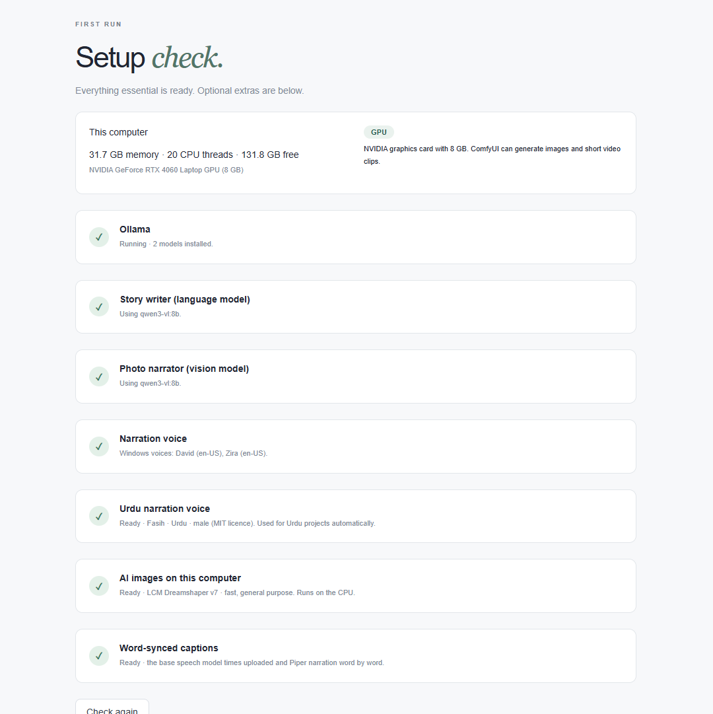
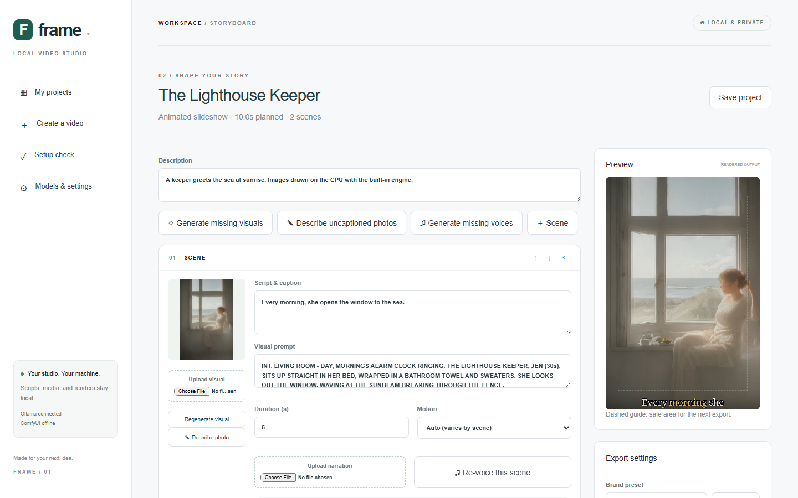

# Frame — local AI video studio

[](https://github.com/qmmughal/texttovideo/actions/workflows/ci.yml)
[](https://github.com/qmmughal/texttovideo/releases/latest)
[](LICENSE)

Turn an idea, a script, or a folder of photos into a narrated, captioned video for Shorts, Reels, or YouTube, entirely on your own computer. Frame writes the storyboard with a local language model, draws scene images on the CPU (or uses ComfyUI on a GPU), narrates in English or Urdu, times captions to the spoken words, and renders MP4s with FFmpeg. No cloud account or API key is needed, and nothing you make leaves your machine.





*Rendered output. Left and middle: images drawn on a laptop CPU by the built-in engine, Windows narration, and word-synced captions with the spoken word highlighted. Right: an Urdu translation narrated by the built-in Urdu voice.*

## Highlights

- **Works without a graphics card.** A setup check sizes models to your computer, and scene images are drawn on the CPU in about 15 seconds each.
- **Idea → film:** a local Ollama model writes a scene-by-scene storyboard in English or Urdu.
- **Photos → film:** a local vision model (such as `qwen3-vl:8b`) writes narration for each of your photos.
- **English and Urdu narration offline** with built-in neural voices on every OS, or Windows system voices with no download.
- **Word-synced captions** that follow the narration, with full Urdu right-to-left shaping. Sentence captions are also available.
- **Translate a project** between English and Urdu with your local language model, keeping the visuals.
- **Motion and transitions:** per-scene zoom and pan, crossfade, fade through black, or hard cuts.
- **Every social format in one job:** 9:16, 16:9, 1:1, and 4:5, with music ducking and logo placement.
- **Brand presets** save your caption style, colours, transitions, logo, and music as a reusable look.
- **Runs on Windows, Linux, macOS, or Docker**, with a Windows installer.

## Install

Frame runs as one local server at `http://127.0.0.1:8000` (API documentation at `/docs`) and accepts connections from this computer only. After installing, open **Setup check** in the sidebar to download models that suit your hardware. The included sample project renders without any AI models, so you can try the editor straight away.

### Windows installer

Download `Frame-Setup-<version>.exe` from the [latest release](https://github.com/qmmughal/texttovideo/releases/latest) and run it. It installs for the current user without administrator rights, installs Python 3.12 with winget if no Python 3.11+ is found, sets up the Python packages (a few minutes, once), and adds **Frame** to the Start menu. The shortcut starts the server and opens your browser; close its window to stop Frame. Uninstalling removes the program and its Python environment but keeps your projects in the install folder's `data` directory.

### Windows from source

Install Python 3.11+ and Node.js 22+. From PowerShell in this folder:

```powershell
.\setup.ps1
.\start.ps1
```

`start.ps1` opens the browser when the server is ready; press Ctrl+C to stop. `.\start.ps1 -Dev` runs the hot-reloading interface on port 3000 for development. If PowerShell policy blocks scripts, run `powershell -ExecutionPolicy Bypass -File .\setup.ps1` rather than changing machine policy.

### Linux and macOS

Install Python 3.11+ (with `venv`) and Node.js 22+, then:

```sh
./setup.sh
./start.sh
```

Windows system voices are not available here; use the built-in neural voices from Setup check. Everything else works the same.

### Docker

```sh
docker compose up -d
```

This builds Frame, starts it with an Ollama container, and publishes it on `127.0.0.1:8000` only. Projects and models are kept in Docker volumes. Install models from Setup check as usual; they download into the Ollama container. Images and narration run on the CPU inside the container. Besides localhost, Frame contacts only the service names listed in `FRAME_SERVICE_HOSTS`.

FFmpeg comes from the `imageio-ffmpeg` wheel, so no separate install is needed. To use another build, set `FFMPEG_PATH` before starting.

## Setup check



On first run, **Setup check** reads the computer's memory, CPU, free disk space, and graphics card, then recommends a tier:

| Tier | When | Recommended |
| --- | --- | --- |
| Light | under 8 GB memory | `qwen3:1.7b`, `qwen3-vl:2b`; use your own photos for visuals |
| Standard (CPU) | 8–16 GB | `qwen3:4b`, `qwen3-vl:4b`, built-in image engine |
| Strong (CPU) | 16 GB or more | `qwen3:8b`, `qwen3-vl:8b`, built-in image engine |
| GPU | NVIDIA with 8 GB or more | the 8B models, plus ComfyUI for images and video |

Each step has a button that downloads the model through Ollama or from Hugging Face. Downloads show progress, can be cancelled, survive dropped connections, and resume where they stopped. Finished downloads are selected in settings automatically. The dashboard shows a reminder until the essentials are ready.

## Which models do what?

Ollama runs language and vision models only. It has **no text-to-video models**, and its experimental image generation (Z-Image Turbo, FLUX.2 Klein) only ran on macOS and Linux and was removed in Ollama v0.32.6. Frame therefore uses:

| Purpose | Runs in | Good local choices |
| --- | --- | --- |
| Storyboard, translation | Ollama | `qwen3:8b`, `qwen3:4b`, `qwen3:1.7b` |
| Photo narration | Ollama | `qwen3-vl:8b`, `qwen3-vl:4b`, `qwen3-vl:2b` |
| Still images, no GPU | Built-in (OpenVINO) | LCM Dreamshaper v7 int8 |
| Still images, NVIDIA GPU | ComfyUI | Stable Diffusion 1.5 / SDXL checkpoints, FLUX |
| Video clips | ComfyUI | Wan 2.2 (5B runs on ~8 GB VRAM), LTX-Video / LTX-2, HunyuanVideo |
| Narration | Built-in (sherpa-onnx) or Windows | Joe, Cori, Alba (English); Fasih (Urdu) |
| Word timing | Built-in (faster-whisper) | Whisper base |

Very small models such as `llama3.2:1b` work but write weak captions; the setup check steers you to larger ones when your computer can run them.

### Speed on a computer without a graphics card

Everything except AI video clips runs on an ordinary CPU. Measured on a 13th-generation Intel Core laptop (20 threads) unless noted:

| Step | CPU-only speed |
| --- | --- |
| Render a 30 s 1080×1920 Short (6 scenes, motion, crossfades, captions) | about 20 s |
| One AI image (512×768, 4 steps) | about 15 s; the first image also loads the model (about 7 s) |
| One narrated line with a built-in voice | about 1 s |
| Storyboard with a 4B model | about 30–60 s (estimate) |
| Word timing with Whisper base | a few seconds per scene |
| AI video (Wan, LTX) | not practical: minutes to hours per clip |

Older laptops are slower; expect a few times these numbers.

## Making a video



1. **Create a video** and start from an idea or script, or **From my photos**. Choose English or Urdu, duration, style, and canvas.
2. **Generate storyboard.** Each scene has a script (the caption and narration) and an English visual prompt; edit both freely.
3. **Generate missing visuals**, upload your own images or clips, or regenerate one scene.
4. **Generate missing voices**, or upload narration per scene.
5. In export settings choose caption style, transition, fit, music, and logo, tick any extra formats under **Also render**, and **Render**. Download the MP4 and SRT from **Your exports**.

### Photos to story

Choose a vision model in **Models & settings**, then **Create a video → From my photos**. Each photo becomes a scene; the vision model writes narration for it in English or Urdu, continuing from the previous scenes, plus an English description, and titles the film. Use **Describe photo** to rewrite one scene. Photos are downscaled to 1024 px before going to the local model and never leave your computer.

### AI images without a graphics card

The built-in engine uses [OpenVINO GenAI](https://openvinotoolkit.github.io/openvino.genai/) with `OpenVINO/LCM_Dreamshaper_v7-int8-ov` (about 1 GB, MIT licence), a latent consistency model that needs only 4 steps per image. Download it from Setup check and choose **Built-in · runs on CPU** as the image engine; it can also run on Intel graphics or an Intel NPU, though the CPU was faster on the test laptop. Images are drawn at 512×768, 768×512, or 512×512 to match the export shape and then scaled, so they are not high resolution.

### Narration

**Built-in neural voices** work on every operating system (about 80 MB each from Setup check). They are [Piper](https://github.com/OHF-Voice/piper1-gpl) voices run in-process by [sherpa-onnx](https://github.com/k2-fsa/sherpa-onnx). Only voices whose training data allows commercial use are offered:

| Voice | Language | Licence |
| --- | --- | --- |
| Joe | US English, male | CC0 |
| Cori | UK English, female | public domain |
| Alba | Scottish English, female | CC BY 4.0 |
| Fasih | Urdu, male | MIT |

**Windows system voices** need no download and report exact word timings while speaking. Windows ships English voices; Urdu projects automatically use the built-in Urdu voice when Windows has none. Text is passed to the speech engine through a temporary UTF-8 file, never a command line.

**Piper command line** remains available for advanced users who want other Piper voices: set the paths to `piper.exe` and an `.onnx` voice in settings. A voice is never used for a language it does not speak.

### Captions

Choose **Caption style** in export settings:

- **Word-synced:** short phrases of up to five words appear as they are spoken, with the current word in the highlight colour. Timings come from Windows speech (exact) or from the Whisper speech model, which also fills in a missing caption from what was said. Without timings, words are spread evenly over the narration. Urdu phrases are shown whole without per-word colouring, to keep letters joined.
- **Sentences:** long scene text is split into cues at sentence boundaries, each shown for a time proportional to its length.

Captions support size, colour, position, safe margins, burned-in output, and UTF-8 SRT. Noto Naskh Arabic is bundled for Urdu, with RAQM shaping where available and Arabic reshaping plus bidirectional ordering otherwise. This is Naskh, not Nastaliq.

### Translate a project

On a project card, choose **Copy in اردو** (or **English copy** for an Urdu project). Frame makes a copy and your storyboard model translates every caption, the title, and the description. Visuals are kept; narration is cleared because it belongs to the old language. Urdu translations must come back in Urdu script; a reply in Roman Urdu is retried once and otherwise reported.

### Brand presets

**Save look** in export settings stores the caption style and colours, highlight colour, transition, safe area, music volume, logo, and music under a name; **Brand preset** applies it to any project. Media used by a preset is never removed when a project is deleted.

### Rendering details

- Each image scene has a **Motion**: slow zoom in or out, pan in any direction, still, or automatic. Motion is rendered at twice the output resolution for smooth movement.
- **Crossfades** blend pictures only; audio switches exactly at the scene boundary, so narration is never faded out early and total length is unchanged. Up to 150 scenes.
- Image scenes extend to the narration length plus 0.2 s. Video clips shorter than their scene are rejected with an explanation, never silently looped or frozen.
- Crop, contain, and blurred-background fits. Logo top-left with proportional size.
- Output is 30 fps H.264/AAC, yuv420p, fast-start MP4, at 9:16, 16:9, 1:1, 4:5, a preview size, or custom even dimensions up to 3840. Upscaling is conventional resizing, not AI super-resolution.
- Music loops to length with adjustable volume, ducking under narration, and fades.

## Connecting ComfyUI (GPU images and video)

Install and start [ComfyUI](https://docs.comfy.org/installation/system_requirements) on port 8188 and confirm your workflow runs in ComfyUI first. Use only trusted local-inference nodes.

1. Export the tested workflow in **API format**.
2. Replace the positive text prompt with the literal `{{prompt}}`.
3. Paste the JSON into the image or video workflow setting, and set **Model clip length** to the clip duration the workflow produces (frames ÷ fps).
4. Save, then generate visuals. Integer `seed` and `noise_seed` inputs are randomised each time.

`examples/comfy-image-api.json` is a starter for a Stable Diffusion checkpoint. For video, start from the [official Wan 2.2 tutorial](https://docs.comfy.org/tutorials/video/wan/wan2_2). Frame checks node types with `/object_info`, submits `/prompt`, polls `/history`, and fetches output through `/view`. Supported outputs are saved PNG/JPEG/WebP images or MP4/WebM/MOV clips; video mode never falls back to a still image.

## Privacy, reliability, and security

- `data/studio.db` stores projects, settings, jobs, and output metadata; media are UUID-named files under `data/`, and models under `data/models/`. Back up the folder; change its location with `LOCAL_VIDEO_DATA`.
- One background worker runs jobs in order. Editing a project with an active job is blocked. After a restart, unfinished jobs show as **interrupted** and can be retried; completed scene assets are kept.
- Cancelling stops FFmpeg and speech processes immediately and other steps between scenes. A ComfyUI prompt that is already running on a shared server is left to finish, and its output is discarded.
- Uploads are limited to known media types, validated, capped at 512 MB, and renamed. Asset paths cannot leave the data folder. Commands use argument lists, not shell strings. Backend URLs must be localhost (or a listed service name), and CORS plus Origin/Host checks restrict browser access.
- Frame is a single-user app for your own computer, not a multi-user web service. See [SECURITY.md](SECURITY.md).

## Development and testing

See [CONTRIBUTING.md](CONTRIBUTING.md) for the project layout and workflow, and [CHANGELOG.md](CHANGELOG.md) for release history.

```sh
python -m pytest -q          # 43 tests with real FFmpeg renders, run in the project's venv
cd frontend && npm run typecheck && npm run build
```

GitHub Actions runs the backend tests on Ubuntu, Windows, and macOS; the frontend typecheck and build; the Linux setup script with a served-app check; a Docker build and smoke test; and the Windows installer build. Pushing a tag such as `v1.3.0` publishes the installer on a GitHub release.

**Verified on a real Windows 11 laptop:** the full flow from idea to storyboard, CPU images, Windows and built-in voices, Whisper word timing, word-synced crossfade renders, photo narration with `qwen3-vl:8b`, Urdu translation and narration, multi-format export, presets, and a silent install and uninstall of the Windows installer.

**Not verified on real hardware:** Linux and macOS (CI only), `docker compose` with the Ollama container (the image is built and run in CI), ComfyUI image and video generation (no ComfyUI server was available), and long or GPU-heavy workloads.

## License

The application source code is available under the [MIT License](LICENSE). The bundled Noto Naskh Arabic font is licensed separately under the [SIL Open Font License 1.1](frontend/public/fonts/OFL.txt). Third-party dependencies and downloaded models keep their own licences; the MIT licence does not relicense them.
